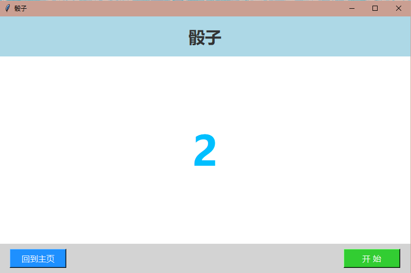

# 骰子

一个纯本地的小窗口程序，**不用联网、不装 Python 也能用**，双击就开。



## 怎么玩

打开以后点右下角的「开 始」，中间的数字就开始飞快滚动，再点一下「暂 停」，数字停下来，那就是你这一把的点数。想重来就点左下角的「回到主页」，回到最开始的样子。


数字是 1 到 6 之间随机出来的，滚得越快越像真的在掷骰子。

## 怎么运行

**方式一：直接双击 exe（Windows，免装 Python）**

到页面右侧的 Releases 下载 `dice.exe`，双击即可。

> 注：exe 由 PyInstaller 打包、没有数字签名，部分杀毒软件可能误报。这是打包工具的常见现象。

**方式二：用 Python 跑源码**

```bash
python 骰子.py
```

Python 3.6 以上即可。窗口用 tkinter，是 Python 自带的库，不需要额外安装。

## 界面说明

| 按钮 | 作用 |
|---|---|
| 开 始 | 开始滚动 / 暂停定格 |
| 回到主页 | 清空数字，回到初始状态 |

## 许可

个人学习使用，自由使用和修改。
